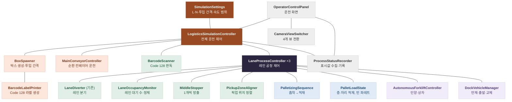
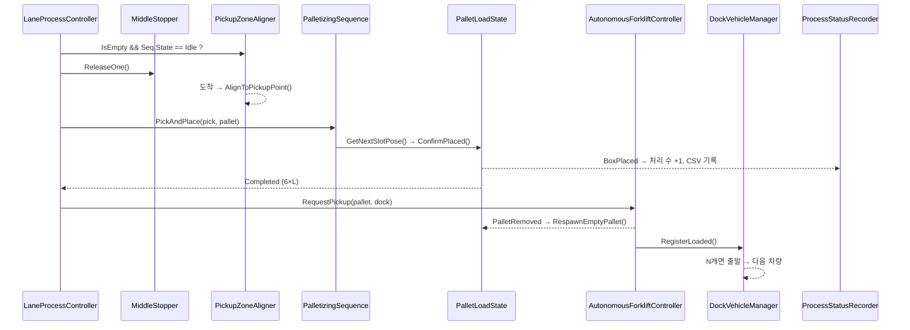

# 물류센터 자동화 클래스 설계

## 1. 전체 구성



로봇 하위 부품(RobotArmInverseKinematics, VacuumGripper)은 PalletizingSequence 안에서만 쓰므로 그림에서 뺐다. 전체 관계는 5장 다이어그램 참조.

## 2. 클래스 목록과 근거

| 분류 | 클래스 | 역할 | 근거 |
|---|---|---|---|
| 공정 제어 | LogisticsSimulationController | 시작·일시정지·재개·초기화·생산 속도, 설정 선택 | FR-21, FR-23 |
| 공정 제어 | LaneProcessController | 레인-AMR-도크 전담 연결, 방출→적재→완료 신호 진행 | FR-13, FR-19, FR-20 |
| 설정 | SimulationSettings | L, N, 층당 6개, 투입 간격, 속도 범위 | FR-04, FR-12, FR-16, FR-21, FR-23 |
| 박스 | LogisticsBox | 박스 타입, 바코드 라벨 표시, 판독 결과 | FR-03, FR-06, 박스 타입 추가 대비 |
| 투입 | BoxSpawner | 박스 생성, 투입 간격 유지, 정체 레인 박스 투입 중지 | FR-03, FR-04, FR-19 |
| 이송 | MainConveyorController | 순환 컨베이어 상시 운전·속도 | FR-05, FR-21 |
| 투입 | BarcodeLabelPrinter | L01·L02·L03 Code 128 라벨 이미지 생성 | FR-06 |
| 분류 | BarcodeScanner | 판독점 카메라 이미지에서 Code 128 판독 | FR-06 |
| 분류 | LaneDiverter (기존) | 판독 결과대로 레인 분기 | FR-07 |
| 레인 | BrakeRollerZone (기존) | 무동력 경사 레인 속도 상한 | FR-08 |
| 레인 | LaneOccupancyMonitor | 순환 대기 수 집계, 정체 판정·해제 | FR-19 |
| 레인 | MiddleStopper | FR5 취급 중 닫고, 픽업 가능하면 1개만 방출 | FR-19, FR-22 |
| 레인 | PickupZoneAligner | 도착한 박스를 PickupPoint 위치·회전으로 정렬, 픽업 구역이 비었는지 | FR-19, FR-22 |
| 로봇 | RobotArmInverseKinematics | FR5 해석적 IK(아래 방향 툴, 위치·yaw)와 관절 이동 | FR-10 |
| 로봇 | VacuumGripper | 흡착·해제 | FR-09 |
| 로봇 | PalletizingSequence | 흡착점→적재점 동작 순서 | FR-09, FR-10 |
| 파레트 | PalletLoadState | 지정 적재 위치, 층별 6자리, 6×L 완료, 빈 파레트 재생성 | FR-10, FR-11, FR-12, FR-20 |
| 운반 | AutonomousForkliftController | 완료 신호 → 경로 이동·장애물 정지·인양·상차·재시도 | FR-13, FR-14, FR-15 |
| 출하 | DockVehicleManager | 차량 상차 수, N개 만재, 출발·다음 차량 | FR-16, FR-17, FR-20 |
| 화면 | CameraViewSwitcher | 전체·분류·FR5·도크 뷰 전환 | FR-02 |
| 화면 | OperatorControlPanel | 운전 조작, 설정 선택, 상태·정체 알람 표시 | FR-02, FR-18, FR-19, FR-21, FR-23 |
| 기록 | ProcessStatusRecorder | 표시값 수집, 같은 값을 기록 | FR-18 |

### 폴더 구성 (`Assets/Scripts/`, namespace `Logistics`)

모든 스크립트는 `namespace Logistics` 안에 작성한다. 기존 3개 스크립트(`Assets/Scripts/Logistics/` 아래)는 구현할 때 .meta 파일과 함께 아래 폴더로 옮긴다. .meta를 같이 옮기면 씬의 컴포넌트 연결은 유지된다.

```
Core/        LogisticsSimulationController, LaneProcessController, SimulationSettings, LogisticsEnums
Box/         LogisticsBox
Input/       BoxSpawner, BarcodeLabelPrinter
Conveyor/    MainConveyorController
Sorting/     BarcodeScanner, LaneDiverter(기존)
Lane/        LaneOccupancyMonitor, MiddleStopper, PickupZoneAligner, BrakeRollerZone(기존)
Robot/       RobotArmInverseKinematics, RobotArmKinematicsSolver, VacuumGripper, PalletizingSequence
Pallet/      PalletLoadState
Forklift/    AutonomousForkliftController
Shipping/    DockVehicleManager
Camera/      CameraViewSwitcher
UI/          OperatorControlPanel, ProcessStatusRecorder
```

## 3. 열거형

`Core/LogisticsEnums.cs` 한 파일에 모은다.

| enum | 값 | 용도 | 근거 |
|---|---|---|---|
| BoxType | Standard | 박스 종류. Standard = 180×140×170mm, 2kg (10/29 변경, 구 360×280×340mm). 새 박스는 값을 추가 | FR-03, 박스 타입 추가 대비 |
| DestinationLane | Lane1, Lane2, Lane3 | 목적 레인. 바코드 L01·L02·L03과 대응 | FR-07 |
| SettingsPreset | Default, Demonstration | 기본(L=3, N=10)·시연(L=2, N=3) 설정 선택 | FR-23 |
| SimulationRunState | Stopped, Running, Paused | 전체 운전 상태 | FR-21 |
| CameraView | Overview, Sorting, Palletizing, Dock | 카메라 뷰 | FR-02 |
| PalletizingState | Idle, Picking, Placing, Returning | FR5 설비 상태 (화면 표시) | FR-09, FR-18 |
| PalletizingResult | Success, NoBox, PalletFull, Busy, PickMoveFailed, AttachFailed, CarryMoveFailed, Dropped, PlaceCheckFailed | 박스 1개 적재 결과. Success일 때만 적재 수 증가 | FR-09, FR-10 |
| VacuumAttachResult | Attached, NoBox, AlreadyHolding, TooFar, OffCenter, Tilted | 흡착 시도 결과 | FR-09 |
| ForkliftState | Idle, MovingToPallet, Lifting, MovingToDock, Loading, Returning, StoppedByObstacle | AMR 설비 상태 (화면 표시) | FR-13~15, FR-18 |

바코드 문자열(L01·L02·L03)을 DestinationLane으로 바꾸는 일은 BarcodeScanner의 `TryParseLane`이, 레인을 라벨 문자열로 바꾸는 일은 BarcodeLabelPrinter가 한다.

## 4. 클래스 상세

표의 "용도"가 그대로 코드의 한글 주석이 된다.

### 4.1 공정 제어

#### LogisticsSimulationController
**클래스 용도**: 전체 운전 상태를 관리하고 공통 설비와 레인 3개에 시작·일시정지·재개·초기화·속도를 전달한다. 씬에 1개. (FR-21, FR-23)

| 변수 | 타입 | 용도 |
|---|---|---|
| defaultSettings | SimulationSettings | 기본 설정 (L=3, N=10) |
| demonstrationSettings | SimulationSettings | 시연 설정 (L=2, N=3) |
| boxSpawner | BoxSpawner | 박스 투입 |
| mainConveyor | MainConveyorController | 메인 컨베이어 |
| laneProcesses | LaneProcessController[3] | 레인 1~3 |
| State | SimulationRunState | 운전 상태 |
| ActivePreset | SettingsPreset | 적용 중인 설정 |
| SpeedMultiplier | float | 생산 속도 배율 |

| 함수 | 용도 |
|---|---|
| StartSimulation() | 운전 시작 |
| PauseSimulation() | 일시정지 (구현: Time.timeScale = 0으로 무동력 레인 박스까지 함께 정지) |
| ResumeSimulation() | 재개 |
| ResetSimulation() | 초기화 버튼: 운전 정지 후 모든 설비의 ResetToInitialState() 호출 |
| SetSpeedMultiplier(float) | 생산 속도 조절 (설정의 범위 안) |
| SelectPreset(SettingsPreset) | 기본/시연 설정 선택 |

#### LaneProcessController
**클래스 용도**: 레인 하나와 전담 AMR·도크를 묶고, 중간 스토퍼 방출 → 로봇 적재 → 파레트 완료 신호 순서를 진행한다. 레인당 1개. (FR-13, FR-19, FR-20)

| 변수 | 타입 | 용도 |
|---|---|---|
| lane | DestinationLane | 레인 번호 |
| occupancyMonitor | LaneOccupancyMonitor | 레인 대기 수 |
| middleStopper | MiddleStopper | 중간 스토퍼 |
| pickupZone | PickupZoneAligner | 픽업 구역 |
| palletizing | PalletizingSequence | 이 레인 FR5 |
| pallet | PalletLoadState | 이 레인 파레트 |
| forklift | AutonomousForkliftController | 전담 AMR |
| dock | DockVehicleManager | 전담 도크 |
| simulatedPickSeconds | float | 로봇 대체 시험용. palletizing·pallet가 연결되지 않은 레인만 사용 |
| UsesRobot / IsHaltedByFailure / PalletCompleteSignaled | bool | 로봇 적재 연결 / 적재 실패로 멈춤 / 6×L 완료 신호 보냄 |

| 함수 | 용도 |
|---|---|
| Begin(SimulationSettings) | 설정 적용(파레트에 L 전달) 후 레인 운전 시작 |
| Pause() / Resume() | 일시정지·재개 전달 |
| ResetToInitialState() | 초기화 버튼: 레인 순서 진행 중지, 레인 설비 초기화 호출 |
| RunLaneLoop() | 방출 → 적재 반복 코루틴. 픽업 구역이 비고, 앞서 방출한 박스가 픽업에 도착했고, FR5가 취급 중이 아닐 때만 방출 (10/30: 정렬된 박스를 PalletizingSequence.PickAndPlace로 적재, 성공 때만 처리 수 증가. 실패 시 그 레인 정지. 로봇 미연결 레인만 simulatedPickSeconds 대체) |
| OnPalletCompleted() | 적재 완료 신호를 전담 AMR에 1회 전달 (AMR 연결 전에는 기록만 하고 그 레인 적재 중지) |

#### SimulationSettings (ScriptableObject)
**클래스 용도**: 공정 설정값. 기본·시연 에셋 2개를 만든다. (FR-04, FR-12, FR-16, FR-21, FR-23)

| 변수 | 타입 | 용도 |
|---|---|---|
| preset | SettingsPreset | 기본/시연 구분 |
| palletLayerCount | int | 적재 층 수 L |
| truckPalletCapacity | int | 만재 파레트 수 N |
| BoxesPerLayer | const int = 6 | 층당 박스 수 (고정) |
| spawnIntervalSeconds | float | 박스 투입 간격 (측정 후 확정) |
| speedMultiplierRange | Vector2 | 생산 속도 조절 범위 (측정 후 확정) |

### 4.2 박스·투입·분류

#### LogisticsBox
**클래스 용도**: 박스 Prefab에 붙어 박스 타입, 바코드 라벨 표시, 바코드 판독 결과를 가진다. 판독 결과는 BarcodeScanner만 쓴다. 기존 BoxRouting을 대체. (FR-03, FR-06, 박스 타입 추가 대비)

| 변수 | 타입 | 용도 |
|---|---|---|
| boxType | BoxType | 박스 종류 |
| labelRenderer | Renderer | 바코드 라벨을 표시하는 박스 면 |
| ReadLane | DestinationLane | 판독한 목적 레인 |
| HasReadResult | bool | 판독 여부 |

| 함수 | 용도 |
|---|---|
| ApplyLabel(Texture2D) | 라벨 이미지를 박스 면에 표시 |
| SetReadResult(DestinationLane) | 판독 결과 기록 |
| SetHeld(bool) / IsHeld | 흡착 중 표시 (VacuumGripper가 설정, 정렬기·감속 구역이 흡착 중 박스를 건드리지 않음) |
| SetPlacedOnPallet() | 파레트에 놓인 박스를 다시 잠들 수 있게 하고 해석 반복 16회로 (잠들지 않는 박스를 쌓으면 미끄러짐) |

#### BoxSpawner
**클래스 용도**: 투입점에 정한 간격으로 박스를 생성한다. 정체된 레인 바코드의 박스는 투입하지 않는다. (FR-03, FR-04, FR-19)

| 변수 | 타입 | 용도 |
|---|---|---|
| boxPrefabs | GameObject[] | 박스 타입별 Prefab (BoxType 순서) |
| spawnPoint | Transform | 투입점 |
| spawnBoxType | BoxType | 생성할 박스 타입 |
| labelSequence | DestinationLane[] | 생성할 바코드 순서 |
| labelPrinter | BarcodeLabelPrinter | 라벨 이미지 생성 |
| laneMonitors | LaneOccupancyMonitor[3] | 레인별 투입 허용 확인 |

| 함수 | 용도 |
|---|---|
| Begin(float interval) / Stop() | 투입 시작·중지 |
| SpawnLoop() | 간격마다 다음 바코드 확인 후 생성하고 라벨을 붙이는 코루틴 |
| ResetToInitialState() | 초기화 버튼: 투입 중지, 씬의 모든 박스 제거, 라벨 순서 처음으로 |

#### BarcodeLabelPrinter
**클래스 용도**: ZXing.Net `BarcodeWriter`(Format = CODE_128)로 L01·L02·L03 라벨 이미지를 만들어 둔다. 레인마다 한 번만 만들고 같은 이미지를 재사용한다. (FR-06)

| 변수 | 타입 | 용도 |
|---|---|---|
| labelWidth / labelHeight | int | 라벨 이미지 픽셀 크기 |
| labels | Dictionary&lt;DestinationLane, Texture2D&gt; | 만들어 둔 라벨 |

| 함수 | 용도 |
|---|---|
| GetLabel(DestinationLane) : Texture2D | 레인 라벨 반환 (없으면 생성) |
| CreateLabel(DestinationLane) : Texture2D | `BarcodeWriter.Encode(text)` 결과 BitMatrix를 검정·흰색 Color32[]로 칠해 텍스처 생성. 프로젝트의 ZXing 0.15.0 Unity 빌드는 `Write(text)`의 Color32 출력에 투명 픽셀이 섞여 판독에 실패한다(10/29 확인) |
| ToBarcodeText(DestinationLane) : string | 레인 → L01·L02·L03 |

#### MainConveyorController
**클래스 용도**: 순환 컨베이어를 운전 중 상시 구동한다. 레인 정체로는 멈추지 않는다. (FR-05, FR-21)

| 변수 | 타입 | 용도 |
|---|---|---|
| loopRoot | Transform | MainLoop 루트 (컨베이어 수집) |
| baseSpeed | float | 기준 속도 |

| 함수 | 용도 |
|---|---|
| Run() / Stop() | 구동·정지 (일시정지 전용) |
| SetSpeedMultiplier(float) | 속도 배율 적용 |
| ResetToInitialState() | 초기화 버튼: 정지, 속도 배율 1 |

#### BarcodeScanner
**클래스 용도**: 판독점에 박스가 들어오면 판독 카메라 화면을 한 번 읽어 ZXing.Net `BarcodeReader.Decode(Color32[], width, height)`로 Code 128을 해독하고 결과를 LogisticsBox에 기록한다. ZXing의 `BarcodeReader`와 이름이 겹치지 않게 BarcodeScanner로 한다. (FR-06)

| 변수 | 타입 | 용도 |
|---|---|---|
| readCamera | Camera | 판독 카메라 |
| readTrigger | Collider | 판독점 감지 |
| captureTexture | RenderTexture | 판독 카메라 출력 |
| decoder | ZXing.BarcodeReader | 해독기 (PossibleFormats = CODE_128) |
| BoxRead | event Action&lt;LogisticsBox&gt; | 판독 완료 알림 (레인 집계용) |

| 함수 | 용도 |
|---|---|
| OnTriggerEnter(Collider) | 박스 진입 시 판독 1회. 구현: readTrigger가 자식 트리거라 콜백이 오지 않으므로 매 프레임 영역 조회, 박스 중심이 카메라 중심선(흐름 방향 ±0.05m)에 오면 촬영, 실패 시 최대 4회 |
| CapturePixels() : Color32[] | 판독 카메라 화면을 픽셀로 읽기 |
| TryDecode(Color32[], out string) : bool | ZXing으로 해독 |
| TryParseLane(string, out DestinationLane) : bool | 판독 문자열 L01·L02·L03을 레인으로 변환 |

#### LaneDiverter (기존)
판독 결과가 담당 레인이고 `AcceptsBoxes`가 참이면 분기한다. 판독 결과 참조를 BoxRouting에서 LogisticsBox로(`LaneDiverter.cs:110`), 담당 레인 `laneId`(string)를 `lane`(DestinationLane)으로 바꾼다. 바꾼 뒤 씬의 LaneDiverter 3개 Inspector에서 레인 값을 다시 지정한다. 기존 `BoxRouting.cs`는 삭제한다. (FR-07)

| 변수 | 타입 | 용도 |
|---|---|---|
| lane | DestinationLane | 담당 레인 |
| arm | Rigidbody | 플리퍼 암 |
| section | Rigidbody | 암 아래 구간 벨트 |
| AcceptsBoxes | bool | 분기 허용 (LaneOccupancyMonitor가 설정) |
| IsDiverting | bool | 분기 중 |
| Diverted | event Action&lt;Rigidbody&gt; | 분기 성공 |

| 함수 | 용도 |
|---|---|
| Play() / Stop() | 구동·정지 |

### 4.3 레인

#### LaneOccupancyMonitor
**클래스 용도**: 레인별 순환 대기 수를 세고, 순환 3개에서 정체, 2개 유지, 1개 이하에서 해제한다. 순환 대기는 판독 후 분기 장치를 분기 없이 지나 메인을 다시 도는 박스다(10/29 구현 변경: 판독 시점부터 세면 투입 간격 6초에서 이동 중 박스만으로 정체가 난다). 정체 중에는 새 투입만 막고 순환 중인 박스 분기는 계속 허용한다. 중간 1개·픽업 1개 제한은 MiddleStopper와 PickupZoneAligner가 지킨다. (FR-19)

| 변수 | 타입 | 용도 |
|---|---|---|
| lane | DestinationLane | 감시 레인 |
| barcodeScanner | BarcodeScanner | 판독 완료 수신 |
| diverter | LaneDiverter | 분기 성공 수신 |
| CirculatingCount | int | 순환 대기 수 (분기 없이 통과한 이 레인 박스) |
| IsCongested | bool | 정체 상태 |
| CongestionChanged | event Action&lt;bool&gt; | 정체 알람 |

| 함수 | 용도 |
|---|---|
| OnBoxRead(LogisticsBox) | 이 레인 판독 수 집계 |
| OnBoxPassed(Rigidbody) | LaneDiverter.BoxPassed 수신: 순환 대기 +1 (10/29 추가) |
| OnBoxDiverted(Rigidbody) | 분기 성공 시 순환 대기 −1, 레인 대기 +1 → 분기 장치 AcceptsBoxes 끔 |
| OnBoxReleased(Rigidbody) | 중간 스토퍼 방출 시 레인 대기 −1 → AcceptsBoxes 켬 (중간 1개 제한) |
| UpdateCongestion() | 3/2/1 기준으로 정체 판정 |
| ResetToInitialState() | 초기화 버튼: 집계 0, 정체 해제 |

#### MiddleStopper
**클래스 용도**: 경사 레인 중간에서 박스 1개를 대기시키고, 명령을 받으면 1개만 통과시킨 뒤 닫는다. 끝 스토퍼와 별도 설비. (FR-19, FR-22)

| 변수 | 타입 | 용도 |
|---|---|---|
| stopperBody | Rigidbody | 스토퍼 막대 |
| holdSensor | Collider | 스토퍼 앞 박스 감지 |
| HasWaitingBox | bool | 대기 박스 있음 |

| 함수 | 용도 |
|---|---|
| ReleaseOne() | 열기 → 1개 통과 → 닫기 코루틴 |
| ResetToInitialState() | 초기화 버튼: 스토퍼 닫힘 |

#### PickupZoneAligner
**클래스 용도**: 레인을 내려온 박스가 픽업 구역에 도착하면 PickupPoint에 지정한 위치·회전값으로 박스를 옮겨 놓고 FR5가 집을 수 있게 한다. 픽업 구역이 비었는지도 알려 준다. ML(CNN)을 추가하면 카메라로 박스 위치·회전을 확인해 집는 방식으로 바꾼다(FR-24). (FR-19, FR-22)

| 변수 | 타입 | 용도 |
|---|---|---|
| pickupPoint | Transform | 박스를 놓을 지정 위치·회전 |
| arrivalSensor | Collider | 도착 감지 |
| CurrentBox | LogisticsBox | 픽업 구역의 박스 |
| IsEmpty | bool | 구역이 비었음 |

| 함수 | 용도 |
|---|---|
| OnTriggerEnter(Collider) | 박스 도착 감지 |
| AlignToPickupPoint(LogisticsBox) | 박스를 지정 위치·회전으로 옮기고 정지시킴 |
| ResetToInitialState() | 초기화 버튼: 구역 비움 |

#### BrakeRollerZone (기존)
무동력 경사 레인에서 박스 속도가 상한을 넘지 않게 한다. 변경 없음. (FR-08)

| 변수 | 타입 | 용도 |
|---|---|---|
| maxSpeed | float | 속도 상한 (0.6 m/s) |
| MaxSpeed | float | 속도 상한 읽기 |

| 함수 | 용도 |
|---|---|
| FixedUpdate() | 상한을 넘는 내리막 속도 제거 |

### 4.4 로봇·파레트

#### RobotArmInverseKinematics
**클래스 용도**: 흡착 툴이 아래를 향한 목표(월드 위치·수평 회전)를 RobotArmKinematicsSolver로 관절 각도로 바꾸고 ArticulationBody 구동 목표로 옮긴다. 닿지 않거나 관절 제한 밖인 목표는 움직이지 않고 실패로 남긴다. 루트(FR5_LaneN) 원점·방향이 로봇 베이스이며, 받침 높이는 씬의 루트 위치(0.60 m)로 정해진다. (FR-10)

| 변수 | 타입 | 용도 |
|---|---|---|
| joints | ArticulationBody[6] | URDF 관절 j1~j6 |
| homeJointAngles | float[6] | 홈 자세 (도, URDF 부호). 레인1·2 = 0, -90, -90, -90, 90, 0 / 레인3 j1 = 90 |
| toolLength | float = 0.15 | 플랜지 → 흡착면 (소형 SMC 4컵 명목 TCP, 접촉면 보정 후 확정) |
| jointSpeedDegrees | float = 45 | 관절 최대 속도 (도/초) |
| reachToleranceDegrees | float = 1 | 도달 판정 오차 (도) |
| settleTimeoutSeconds | float = 3 | 구동 목표 이후 도달 대기 시간 |
| linearStepMeters | float = 0.02 | 직선 이동 경로점 간격 |
| IsMoving / LastMoveSucceeded / LastReachError | bool / bool / float | 이동 중 / 마지막 이동 성공 / 마지막 도달 오차 (m) |
| referenceOffsets | double[6] | 관절 0도가 가리키는 URDF 각도. 씬이 다른 자세로 저장돼 관절 기준이 바뀐 경우를 앵커 회전으로 계산해 보정 |

| 함수 | 용도 |
|---|---|
| WorldToBase(Vector3) / BaseToWorld(Vector3): Vector3 | Unity 월드 ↔ 베이스 오른손 좌표 (X 앞, Y 왼쪽, Z 위) |
| GetJointAngles(): float[] / CurrentToolPosition: Vector3 | 현재 관절 각도 (도) / 흡착면 월드 위치 |
| ForwardKinematics(angles: float[]): Vector3 | 관절 각도 → 흡착면 월드 위치 |
| SolveDownwardTool(position, yaw, out angles): bool | 툴 아래 방향 해 중 현재 자세와 가장 가까운 해. 없으면 false |
| MoveTo(position, yaw): IEnumerator | 관절 보간 이동 |
| MoveLinear(position, yaw): IEnumerator | 흡착면 직선 이동 (접근·하강·상승). 경로점 하나라도 해가 없으면 출발하지 않음 |
| MoveToJointAngles(angles): IEnumerator / MoveHome(): IEnumerator | 관절 각도 이동 / 홈 복귀 |
| ResetToInitialState() | 초기화 버튼: 진행 중 이동을 끊고 홈 자세로 즉시 배치 |

#### RobotArmKinematicsSolver (static)
**클래스 용도**: FR5 순기구학과 툴 아래 방향 해석적 역기구학 계산 전용. Unity 형식을 쓰지 않아 Unity 밖에서도 시험할 수 있다. 계산식은 `Docs/Research/calculate_fr5_layout.py`의 `fk`·`ik_down`, `FR5_CAD_Validation/verify.py`의 `ik_all` 위치 계산식이며, 옛 받침(950 mm)·툴(182.8 mm) 값은 쓰지 않는다. (FR-10)

| 변수·함수 | 용도 |
|---|---|
| ShoulderHeight 0.152 / UpperArmLength 0.425 / ForearmLength 0.39501 / Wrist1Offset 0.1021 / Wrist2Offset 0.102 / FlangeOffset 0.100 | URDF 링크 치수 (m) |
| LowerLimits / UpperLimits | 관절 제한 (rad). URDF 값, j3만 제조사 ±160° |
| ForwardKinematics(q, toolLength, position, rotation) | 관절 → 흡착면 위치·툴 자세 |
| SolveDownwardToolAll(x, y, z, yaw, toolLength): List | 모든 해 (yaw·yaw+180° 대칭, 2π 차이 포함, 제한 밖 제외, 순기구학 재검사) |
| SolveDownwardTool(..., currentAngles, out best): bool | 현재 자세와 가장 가까운 해 |

#### VacuumGripper
**클래스 용도**: 흡착면이 박스 윗면에 실제로 닿아 있을 때만 박스를 붙이고 적재점에서 해제한다. 툴 루트(VacuumTool, wrist3_link 자식)에 레인마다 1개. (FR-09)
흡착 중 물리 상태: 박스(2 kg)는 동적 Rigidbody 그대로 두고 중력만 끈 뒤, 붙인 순간의 흡착점 기준 상대 자세를 유지하도록 매 물리 단계 속도·각속도를 맞춘다(순간 이동·부모 변경 없음). 해제 시 중력 복구, 속도 0. 툴 가속도로 계산한 필요 흡착력 m·|a − g|가 holdForce를 넘으면 떨어뜨린다.
정렬기가 kinematic으로 고정한 박스는 흡착할 때 고정을 풀어 동적으로 바꾸고 `LogisticsBox.IsHeld`를 켠다(정렬기·감속 구역이 흡착 중 박스를 건드리지 않음).
쓰지 않는 방식(10/30 시험 근거): FixedJoint↔ArticulationBody 연결, 박스·로봇 Physics.IgnoreCollision(둘 다 Unity 비정상 종료), kinematic 추종(툴과 겹칠 때 로봇을 밀어 흔들림).

| 변수 | 타입 | 용도 |
|---|---|---|
| suctionPoint | Transform | 흡착면 중심 (VacuumTool/SuctionPoint, +Y = 흡착 방향) |
| toolLink | ArticulationBody | 툴이 붙은 링크 (wrist3_link) |
| contactDistance | float = 0.01 | 흡착면 ↔ 박스 윗면 허용 간격 (m) |
| centerTolerance | float = 0.03 | 중심 허용 어긋남 (m) |
| tiltToleranceDegrees | float = 10 | 툴 축 ↔ 윗면 수직 허용 각도 |
| holdForce | float = 100 | 흡착 유지 힘 (N, 명목값·컵 사양 확인 후 조정) |
| HeldBox / IsHolding | LogisticsBox / bool | 흡착 중인 박스 |
| LastAttachResult | VacuumAttachResult | Attached·NoBox·AlreadyHolding·TooFar·OffCenter·Tilted |
| LastRequiredForce / PeakRequiredForce | float | 필요 흡착력 (N) |
| Attached / Released / Dropped | event Action&lt;LogisticsBox&gt; | 흡착 / 해제 / 흡착력 초과로 떨어짐 |

| 함수 | 용도 |
|---|---|
| FindBoxUnderSuction(): LogisticsBox | 흡착면 아래 0.05 m 안의 박스 |
| TryAttach(LogisticsBox): VacuumAttachResult | 접촉 조건 검사 후 흡착 |
| Release(): bool | 해제 |
| ResetToInitialState() | 초기화 버튼: 흡착 해제 (박스는 BoxSpawner가 제거) |

#### PalletizingSequence
**클래스 용도**: 픽업 구역에 정렬된 박스 1개를 흡착해 파레트의 다음 지정 자리에 놓는다. 로봇 루트(FR5_LaneN)에 레인마다 1개. (FR-09, FR-10)
순서: 흡착점 위 접근 → 직선 하강 → 흡착 → 정렬기 ClearZone → 운반 높이로 직선 상승 → 자리 위 이동 → 직선 하강 → 해제 → 박스 SetPlacedOnPallet → 안정 대기 → 놓인 위치·수평 확인 → 성공 시에만 PalletLoadState.ConfirmPlaced → 상승 → 홈. 운반 높이 = max(파레트 L층 윗면, 픽업 박스 윗면) + 박스 높이 + 여유. 픽업 yaw = 박스 yaw, 적재 yaw = 자리 yaw.

| 변수 | 타입 | 용도 |
|---|---|---|
| arm | RobotArmInverseKinematics | FR5 팔 |
| gripper | VacuumGripper | 흡착 툴 |
| approachHeight / contactGap | float = 0.10 / 0.003 | 접근 높이 / 흡착 시 흡착면과 윗면 간격 |
| transitClearance / releaseGap | float = 0.08 / 0.005 | 운반 여유 / 해제 높이 |
| settleSeconds / placeTolerance / tiltToleranceDegrees | float = 0.5 / 0.02 / 5 | 해제 후 대기 / 놓인 위치 허용 / 기울기 허용 |
| State | PalletizingState | 설비 상태 |
| LastResult / LastPlaceError | PalletizingResult / float | 마지막 결과 / 놓인 위치 오차 (m) |
| IsBusy | bool | 동작 중 |

| 함수 | 용도 |
|---|---|
| PickAndPlace(PickupZoneAligner, PalletLoadState): IEnumerator | 박스 1개 적재. 결과는 LastResult |
| ResetToInitialState() | 초기화 버튼: 진행 중 순서 중단, 팔 홈 배치, 흡착 해제, Idle |

#### PalletLoadState
**클래스 용도**: 파레트의 사전 지정 적재 위치(층당 6자리)와 적재 수를 관리한다. 배열 순서대로 한 층 6자리를 채운 뒤 다음 층, 6×L이면 완료. 레인마다 PalletLoadPoint에 1개, 자리 표시점은 그 자식 Slot_1~6(박스 사이 10 mm, 180 mm 변이 Z, 로봇에서 먼 자리부터). (FR-10, FR-11, FR-12)
빈 파레트 재생성(RespawnEmptyPallet, emptyPalletPrefab, FR-20)은 AMR 반출 구현(WBS 57·72) 때 작성한다.

| 변수 | 타입 | 용도 |
|---|---|---|
| layerSlots | Transform[6] | 한 층 6자리 (박스 바닥 중심·방향, 1단) |
| layerHeight | float = 0.17 | 층 높이 |
| layerCount | int | L (운전 시작 때 설정값) |
| PlacedCount / CurrentLayer / Capacity | int | 적재 수 / 현재 층 / 6×L |
| IsComplete | bool | 6×L 완료 |
| StackTopHeight | float | L층 윗면 높이 (운반 높이 계산) |
| BoxPlaced / Completed | event Action | 박스 1개 적재 / 완료 1회 |

| 함수 | 용도 |
|---|---|
| Configure(int layerCount) | L 적용 (적재 중에는 바꾸지 않음) |
| GetNextSlotPose(out Pose): bool | 다음 자리. 완료·자리 없음이면 false |
| ConfirmPlaced() | 놓인 위치 확인된 박스 1개 계수, 6×L이면 Completed |
| ResetToInitialState() | 초기화 버튼: 적재 수 0 |

#### AutonomousForkliftController
**클래스 용도**: 전담 레인의 완료 신호를 받으면 경로를 탐색해 이동하고 장애물이면 정지하고, 장애물이 사라진 뒤 5초가 지나면 재개한다. 완성 파레트를 인양해 전담 도크 차량에 상차하고 실패하면 재시도한다. (FR-13, FR-14, FR-15)

| 변수 | 타입 | 용도 |
|---|---|---|
| homePoint | Transform | 대기 위치 |
| navigationAgent | NavMeshAgent | 경로 탐색·이동 |
| obstacleSensor | Collider | 장애물 감지 |
| maximumLoadRetries | int | 상차 재시도 횟수 (시험 후 확정) |
| resumeDelaySeconds | float = 5 | 장애물이 사라진 뒤 재개까지 대기 시간 |
| State | ForkliftState | 설비 상태 |
| PalletRemoved | event Action | 파레트 반출 완료 (빈 파레트 생성용) |

| 함수 | 용도 |
|---|---|
| RequestPickup(PalletLoadState, DockVehicleManager) | 완료 신호 수신 후 운반 시작 |
| TransportRoutine() | 이동 → 인양 → 도크 이동 → 상차·재시도 → 복귀 코루틴 |
| WaitForObstacleClear() | 장애물 정지 후 사라짐을 확인하고 5초 대기하는 코루틴 |
| ResetToInitialState() | 초기화 버튼: 운반 중지, 들고 있던 파레트 제거, 대기 위치로 즉시 배치, State = Idle |

#### DockVehicleManager
**클래스 용도**: 도크에 있는 차량의 상차 파레트 수를 세고, N개면 만재로 출발시킨다. 출발한 차량은 실린 박스·파레트를 제거하고 처음(빈) 상태로 도크에 다시 배치한다. (FR-16, FR-17, FR-20)

| 변수 | 타입 | 용도 |
|---|---|---|
| truck | Transform | 도크 전담 차량 |
| dockPoint | Transform | 정차 위치 |
| cargoSlots | Transform[] | 적재함 파레트 자리 |
| LoadedPalletCount | int | 현재 차량 상차 수 |
| IsFull | bool | N개 만재 |

| 함수 | 용도 |
|---|---|
| Configure(int capacity) | N 적용 |
| GetNextCargoSlot() | 다음 상차 자리 |
| RegisterLoaded() | 상차 수 +1, N이면 출발·교체 |
| DepartAndReplaceTruck() | 만재 차량 출발 → 실린 박스·파레트 제거 → 빈 차량으로 도크 재배치 코루틴 |
| ResetToInitialState() | 초기화 버튼: 차량의 파레트·박스 제거, 차량을 도크 위치에 빈 상태로 배치 |

### 4.6 화면·기록

#### CameraViewSwitcher
**클래스 용도**: 4개 카메라 중 선택한 것만 켠다. (FR-02)

| 변수 | 타입 | 용도 |
|---|---|---|
| viewCameras | Camera[4] | CameraView 순서의 카메라 |
| CurrentView | CameraView | 지금 뷰 |

| 함수 | 용도 |
|---|---|
| SwitchTo(CameraView) | 뷰 전환 |
| ResetToInitialState() | 초기화 버튼: 전체 뷰로 |

#### OperatorControlPanel
**클래스 용도**: 운전 조작·설정 선택·뷰 선택을 받아 해당 클래스 함수를 호출하고, ProcessStatusRecorder 값과 정체 알람을 표시한다. (FR-02, FR-18, FR-19, FR-21, FR-23)

| 변수 | 타입 | 용도 |
|---|---|---|
| simulation | LogisticsSimulationController | 운전 명령 대상 |
| cameraSwitcher | CameraViewSwitcher | 뷰 전환 |
| statusRecorder | ProcessStatusRecorder | 표시값 |

| 함수 | 용도 |
|---|---|
| OnStart() / OnPause() / OnResume() / OnReset() | 운전 버튼 |
| OnSpeedChanged(float) | 생산 속도 |
| OnPresetSelected(SettingsPreset) | 설정 선택 |
| OnViewSelected(CameraView) | 뷰 선택 |
| RefreshDisplay() | 표시값·정체 알람 갱신 |

#### ProcessStatusRecorder
**클래스 용도**: 처리 제품, 시간당 생산량, 레인별 대기 수, 적재 단수, 설비 상태, 차량 상차 수를 모아 화면에 주고 같은 값을 박스 1개를 처리(파레트 적재 완료)할 때마다 날짜별 CSV에 한 줄씩 기록한다. 기록은 1달 보관한다. (FR-18)

| 변수 | 타입 | 용도 |
|---|---|---|
| simulation | LogisticsSimulationController | 값 수집 대상 |
| recordFolder | string | 기록 폴더 |
| retentionDays | int = 30 | 기록 보관 기간 (1달) |
| ProcessedBoxCount | int | 총 처리 제품 수 (초기화·차량 교체 때도 유지) |
| BoxesPerHour | float | 시간당 생산량 |

| 함수 | 용도 |
|---|---|
| OpenTodayFile() | 날짜별 CSV 열기. 같은 날 다시 실행하면 그 날 파일에 이어 쓰기 |
| DeleteExpiredFiles() | 보관 기간이 지난 CSV 삭제 |
| CollectStatus() | 설비 값 수집 |
| OnBoxProcessed() | 박스 1개 적재 완료(PalletLoadState.BoxPlaced) 시 처리 수 +1, 값 수집 후 기록 |
| WriteRecord() | 수집한 값을 CSV 한 줄로 기록 |
| ResetToInitialState() | 초기화 버튼: 총 처리 수·생산량 0. CSV 파일은 지우지 않고 초기화 줄을 남김 |

## 5. 클래스 다이어그램


IFEA 클래스 다이어그램 양식을 따른다. 확대용 원본: `ClassDiagram_LogisticsCenter.svg`.

- 박스: 클래스 이름 / 변수(`이름: 타입`) / 함수(`이름(인자: 타입): 반환 타입`). `-`는 private(Inspector 연결 포함), `+`는 public.
- 실선 화살표: 변수로 가진 연결 참조. 위 클래스에서 아래로 나무 모양으로 뻗는다.
- 점선 화살표: 함수 인자로 받거나 박스 데이터(LogisticsBox)를 쓰는 사용 관계. LogisticsBox를 쓰는 클래스의 점선은 아래쪽 한 줄로 모았다.
- 열거형은 연결선 없이 아래 점선 상자에 모았다. 변수 타입으로 쓰인다.

## 6. 레인 1사이클 흐름



## 7. 작성 순서

| 순서 | 클래스 | 이유 |
|---|---|---|
| 1 | LogisticsEnums, SimulationSettings, LogisticsBox | 모든 클래스가 쓰는 데이터 |
| 2 | CameraViewSwitcher | WBS 10/29 TC-02 |
| 3 | BoxSpawner, BarcodeLabelPrinter, MainConveyorController, BarcodeScanner, LaneOccupancyMonitor, MiddleStopper, PickupZoneAligner | 투입~픽업 (TC-03~08, 19, 22) |
| 4 | RobotArmInverseKinematics, VacuumGripper, PalletizingSequence, PalletLoadState | FR5 임포트 후 (TC-09~12) |
| 5 | AutonomousForkliftController, DockVehicleManager | AMR·차량 배치 후 (TC-13~17, 20) |
| 6 | LaneProcessController, LogisticsSimulationController | 설비 연결 (TC-21, 23) |
| 7 | ProcessStatusRecorder, OperatorControlPanel | 표시·기록 (TC-18) |

## 8. 결정이 필요한 사항

1. 상차 재시도 횟수·간격·반복 실패 처리, 투입 간격, 속도 범위 — SRS상 시험 후 확정.
2. 박스 타입을 추가할 때 파레트 적재 위치(층당 6자리)를 타입별로 둘지 — 타입 추가 시점에 결정.
